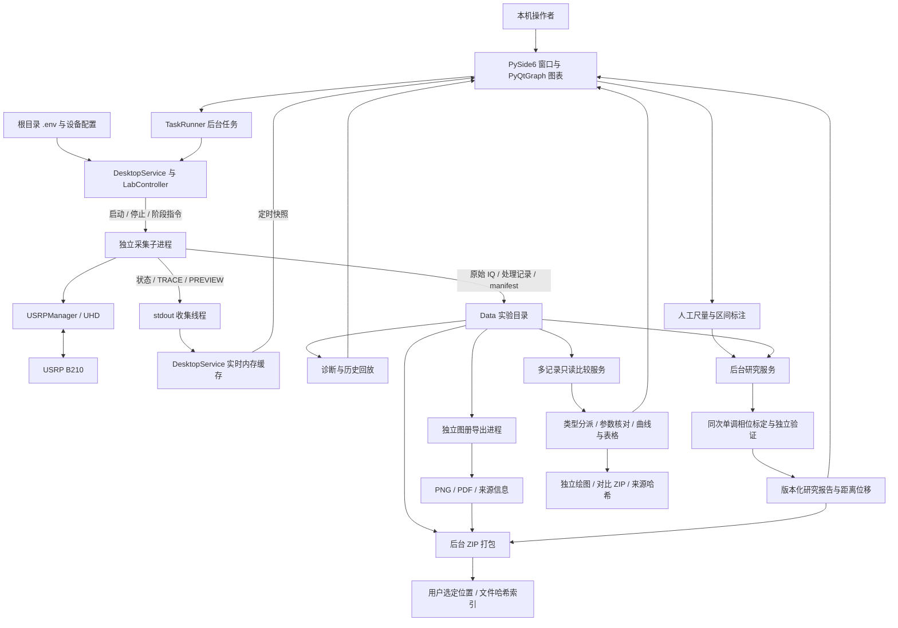
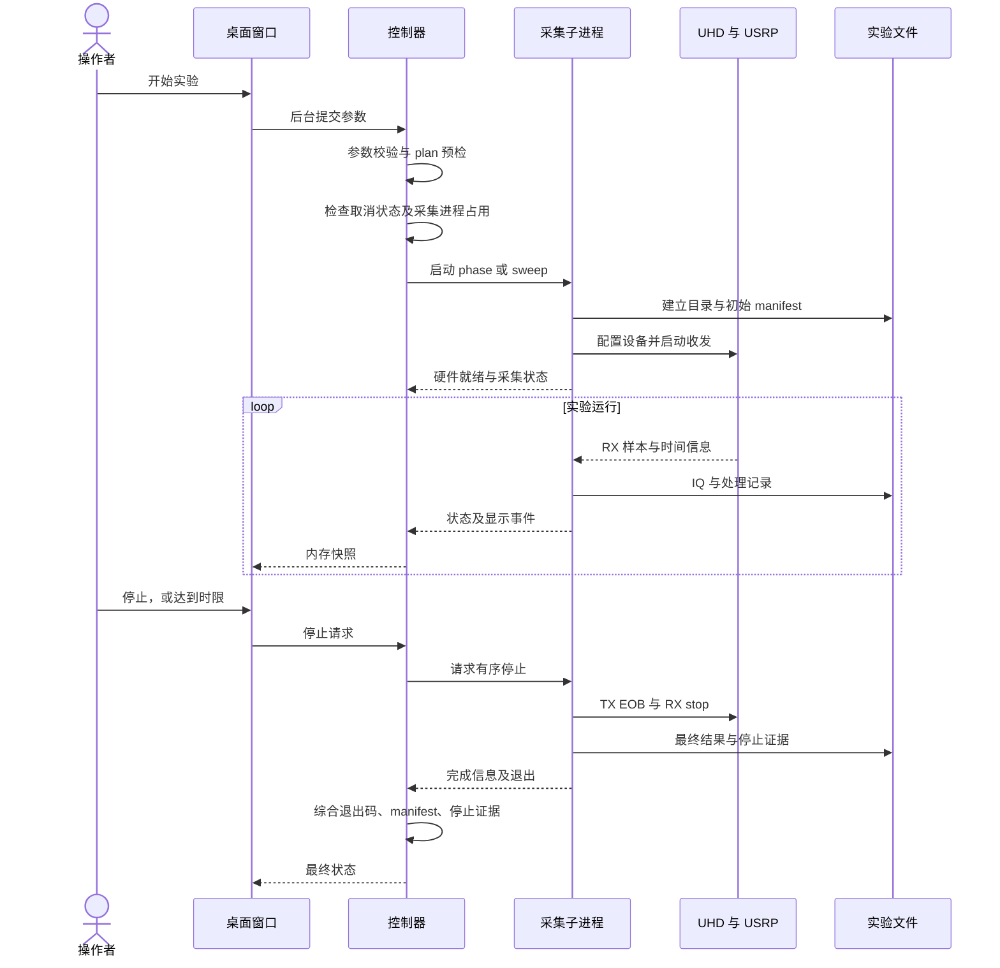

# SSPP 桌面实验软件设计说明与当前进展

> 核对日期：2026-10-10（北京时间）  
> 对象：`sspp-usrp-PySide6-PyQtGraph` 当前代码与已保存实验记录  
> 用途：说明材料扫频、固定频率手指研究工作流，以及采集、标定验证、结果筛选、多记录比较和导出的实现。  
> 本文区分已实现行为、按日期保留的验证证据和后续建议；本轮软件改动不自动构成新硬件或毫米精度验收。

项目位置：`/Users/cunhui/Git-Projects/Academic_Research/sspp-usrp-PySide6-PyQtGraph`。原项目 `sspp-usrp` 保留。本文中的相对链接均相对于本文件。

## 阅读导航

- 想先梳理进展：读 [1. 当前结论](#1-当前结论) 和 [11. 验证记录与边界](#11-验证记录与边界)。
- 想理解程序如何运转：读 [3. 总体架构](#3-总体架构)、[6. 一次实验的生命周期](#6-一次实验的生命周期)、[8. 数据组织](#8-数据组织)。
- 想比较已保存实验：读 [结果比较](results_comparison.md) 和第 7.6、8.6 节。
- 想实际操作：先读 [实验工作流](experiment_workflows.md)，再读 [5. 当前操作流程](#5-当前操作流程) 与 [12. 本轮交互改动与后续事项](#12-本轮交互改动与后续事项)。
- 想继续开发分析或 AI：读 [4. 代码结构](#4-代码结构)、[13. 后续扩展方式](#13-后续扩展方式)、[14. 维护导航](#14-维护导航)。

## 1. 当前结论

当前项目是本人在本机使用的 **PySide6 + PyQtGraph 桌面科研软件**，按 **材料扫频** 和 **固定频率手指实验** 组织。独立 Python 子进程负责 USRP 收发，Qt 负责交互，文件系统保存原始实验及版本化研究结果。唯一日常启动器为根目录 `run_desktop.command`；没有 FastAPI、HTTP 服务、数据库或 AI 功能。

继续使用现有 **Conda `rf-gnuradio`**。这是运行环境，不是 Python 库；硬件控制通过其中的 UHD Python API，目前不通过 GNU Radio 流图运行采集。

| 工作项 | 当前状态 | 结论与边界 |
|---|---|---|
| 两类研究工作区 | 已实现 | 材料按条件扫频，手指使用引导／自由采点、独立区间验证与距离／位移结果 |
| 手指毫米模型 | 同 run 的单调相位经验标定 | 质量、区间独立性和误差全部通过才激活；不是跨会话通用测距模型 |
| 实验 ZIP 导出 | 用户选择保存位置，原始 IQ 默认不选 | 包含参数、结果、已有研究报告、重要图与哈希索引；失败状态不被改写 |
| 已保存实验比较 | 类型／状态／关键词筛选，2–8 条同类完成记录 | 扫频只在可比参数和共同 UHD 回读频点上算差；phase 各自基线相对响应，不跨 run 相减 |
| 历史迁移 | 初次 743 文件／1,049,012,908 字节逐文件哈希一致 | 这是初次迁移统计，不是当前总文件数 |
| 时间戳修复 | 保留主时钟计数校验、拒绝帧证据与实际停止原因 | 不容忍真实 ±1 样本跳变 |
| 离线验证 | 按版本记录在 [验收记录](acceptance_desktop.md) | 旧修复 73 项测试／39 项子测试是当时结果，不是本轮测试数量 |
| 已有真机初验 | 一条约 90.94 秒空载静态连续幅相成功记录 | 支持当时静态采集、基线、主动停止与保存，不支持新版实际毫米精度 |
| 后续验证 | 手指动作、尺量误差、材料扫频、重复性与显示性能 | 需独立的真实实验；本轮开发不自动启动硬件 |

用户先前反馈“初步验证没有问题，但操作不便”，本轮据此重组研究任务入口与结果交付。实现和软件测试证明流程与规则；实际科研结论必须由带真值、条件和独立验证的记录支持。

## 2. 使用目标与核心概念

### 2.1 目标场景

使用者在实际 USRP、传感器和接线旁完成实验：定义条件、确认现场、连续观察、记录人工动作或尺量、停止保存、检验与导出。一次只运行一个受本应用控制的采集。

1. **材料扫频**：一个材料／条件对应一次 run；固定样品后逐点、逐轮测幅度响应。换材料另起记录，技术重复不冒充独立摆放。
2. **固定频率手指**：同次参考下连续记录幅相。引导流程按尺量计划采稳定窗口；自由流程记录动作并支持从保存序列选段。两者共享单调相位标定与独立验证算法。

传感器到手指的距离由操作者定义几何基准并尺量；位移是估计距离减初始尺量距离，远离为正。当前只在同一 run 的验证范围内估计，不能直接把不同相位基线合并。

### 2.2 容易混淆的名称

| 名称 | 含义 | 不应混同的对象 |
|---|---|---|
| 设备配置 `profile` | 自有机或老师机的设备身份、通道和 FPGA 资产引用 | 实验参数模板；目前没有命名实验模板功能 |
| 研究类别／模式 | 材料扫频 `sweep` 或手指固定频率 `phase` | 设备型号；引导／自由不会另开一种采集算法 |
| 实验条件 `condition` | 当前工作区对应 `material` 或 `finger`；历史仍可能为 `empty` | 每次运行期间的人工阶段 |
| 标签 `label` | 材料／条件名或手指会话名 | 自动分类得到的科研标签 |
| 传感器说明 `sensor` | 操作者填写的文字说明 | 程序自动识别的传感器 |
| 人工动作／尺量窗口 | 操作者记录动作，或确认距离后采集稳定窗口 | 自动定位、自动移动、独立检测的物理动作时刻 |
| 标定／独立验证 | 前者拟合曲线，后者评价留出静止区间误差 | 把同一静止段切开、随机拆相邻窗口或跨 run 复用基线 |
| 参考／基线 `baseline` | 本次连续幅相开始时的一段静止参考 | 跨实验共享的绝对相位标定 |
| 控制任务 `job` | 桌面控制器跟踪的运行任务，有独立 ID 和状态 | 数据目录本身 |
| 实验记录 `run` | `Data/` 下的一次保存记录，以 UTC 时间目录定位 | 当前界面正在看的内容一定来自当前任务 |

阶段的过渡等待表示“这段时间正在动作或稳定”，接触报告表示操作者是否接触传感器或线缆。它们用于解释信号变化，不是程序对物理动作的独立检测。

## 3. 总体架构

### 3.1 模块之间的关系



这套结构将三件事分开处理：**可靠采集和保存、及时显示、结束后的分析与导出**。界面接收适合绘图的快照；科研原始数据由采集端保存，不依赖窗口是否及时刷新。

“实时”在这里表示采集过程中持续更新曲线，而不是硬实时调度保证。刷新周期、样本时间、USB 传输时间和界面实际呈现延迟是不同概念。

### 3.2 进程与线程边界

| 执行位置 | 负责工作 | 设计目的及当前边界 |
|---|---|---|
| 桌面进程 Qt 主线程 | 交互、控件更新、绘图、回放时钟 | 不执行真实 RX/TX；phase 回放局部快照的小 FFT 仍在此线程，见第 9 节 |
| `TaskRunner.control` | 预检、开始、人工标记 | 最多 2 个在途任务 |
| `TaskRunner.urgent` | 停止与关闭 | 独立 1 个槽位，避免被分析排队占住 |
| `TaskRunner.analysis` | 历史、详情、诊断、回放加载、尺量分析／研究绘图、多记录比较、ZIP 打包、文件操作 | 同时 1 个任务；在途加排队最多 4 个 |
| `TaskRunner.polling` | 当前状态和实时内存快照 | 同时最多 1 个，避免轮询堆积 |
| 控制器后台线程 | 收集子进程输出、看门狗、停止收尾 | 维护任务状态及最终停止证据 |
| 采集子进程 RX/TX/监测线程 | 收发、原始 IQ 保存、TX 异步事件监测 | 与 Qt 生命周期隔离；phase 主处理循环另外完成 DSP 和逐窗记录 |
| 实时发布输出线程 | 发送展示事件、计算实时 RX 预览 FFT | 预览 FFT 与 stdout 写入移出 RX 线程，显示发布采用非阻塞入队 |
| 导出子进程 | Matplotlib Agg 生成 PNG/PDF | 不依赖 Qt 画布截图，不打开硬件 |

`TaskRunner` 四个线程池最多同时运行 5 个工作任务，这不是整个软件的线程总数。同一任务 key 在完成前不能重复提交；结果通过 Qt 信号回到主线程。

### 3.3 通信方式

父子进程使用本机管道通信，没有网络服务：

- 子进程 stdout 输出状态文本和 JSON 事件，stderr 合并进入收集链路。
- 连续幅相接收 stdin 中的小型 JSON 控制消息，例如停止和阶段标记；控制写入采用非阻塞方式。
- `TRACE` 传递连续幅相处理点，`PREVIEW` 传递最新 RX 诊断窗口，扫频结果通过 `MEASUREMENT` 逐点上报。
- 状态、实时显示、原始保存是不同通路，不能把显示包数当成原始接收帧数。

## 4. 代码结构

```text
sspp-usrp-PySide6-PyQtGraph/
├── run_desktop.command       macOS 启动器
├── run_desktop.py            环境检查、单实例锁、Qt 应用入口
├── .env                     本机配置，不提交 Git
├── .env.example             配置模板
├── requirements-desktop.txt  桌面增量依赖
├── sspp_desktop/             桌面交互、任务调度、绘图、回放
├── sspp_experiments/         两类实验的采集与领域分析
│   ├── material_sweep/       acquisition.py、logic.py
│   └── finger_displacement/  acquisition.py、analysis.py
├── sspp_lab/                 共用控制器、硬件、DSP、诊断、实时通道及兼容入口
├── run_local.py             扫频 CLI 入口
├── run_phase.py             连续幅相 CLI 入口
├── phase_dsp.py              DSP 兼容入口
├── run_teacher.py           老师原 GUI 兼容入口
├── Data/                    设备配置、迁移历史、新实验和派生产物
├── tests/                   控制、时间戳、传输、诊断、桌面回归
├── test_phase_dsp.py         原有 DSP 测试
├── test_run_local.py         原有采集相关离线测试
├── historical/
│   ├── teacher_20260908/     老师代码冻结副本
│   └── web_20261009/         原网页实现快照
└── docs/                    需求、设计、迁移和验收证据
```

当前继续使用根级 Python 包，以保留原采集脚本与来源哈希的相对路径。没有为了形式统一迁移到 `src/`，也没有建立插件框架。

### 4.1 桌面层

| 文件 | 职责 |
|---|---|
| [config.py](../sspp_desktop/config.py) | 读取 `.env`、处理环境变量优先级、检查配置范围与路径 |
| [services.py](../sspp_desktop/services.py) | `DesktopService` 继承控制器；缓存实时点和最新预览；保存桌面上下文 |
| [workers.py](../sspp_desktop/workers.py) | 后台任务分池、重复任务抑制、结果及异常回传 |
| [window.py](../sspp_desktop/window.py) | 主导航、两类参数、五页及按钮状态、历史选择、后台调度、关闭流程 |
| [experiments/material_sweep.py](../sspp_desktop/experiments/material_sweep.py) | 材料／条件命名与扫频研究提示 |
| [experiments/finger_displacement.py](../sspp_desktop/experiments/finger_displacement.py) | 引导／自由现场采点、离线区间编辑、结果与拒绝原因展示 |
| [research.py](../sspp_desktop/research.py) | 标记确认与窗口时序、读入完整序列、源实验校验、同 run 模型与版本保存 |
| [research_export.py](../sspp_desktop/research_export.py) | 后台 Agg 生成研究 PNG／PDF |
| [bundle.py](../sspp_desktop/bundle.py) | 单次实验图册、参数摘要、可选 IQ、流式 ZIP 与哈希索引 |
| [comparison_service.py](../sspp_desktop/comparison_service.py) | 完成记录比较调度、互斥、报告摘要绑定、源文件复核与对比 ZIP |
| [comparison_widget.py](../sspp_desktop/comparison_widget.py) | 独立只读比较窗口、参考切换、比较图、参数和数据表 |
| [comparison_export.py](../sspp_desktop/comparison_export.py) | 独立 Agg 子进程生成比较 PNG／多页 PDF |
| [plots.py](../sspp_desktop/plots.py) | 实时主图、RX 时域／频谱／IQ、离线诊断图的 Qt 渲染 |
| [replay.py](../sspp_desktop/replay.py) | 从保存记录构建只读回放会话与时间定位 |

### 4.2 实验与分析层

| 文件 | 职责 |
|---|---|
| [controller.py](../sspp_lab/controller.py) | 参数与 profile 校验、预检、进程管理、停止、状态、历史、文件访问、诊断及导出调度 |
| [hardware.py](../sspp_lab/hardware.py) | `SDRConfig` 和 `USRPManager`，封装 UHD 配置、设备和 streamer 创建 |
| [finger_displacement/acquisition.py](../sspp_experiments/finger_displacement/acquisition.py) | 连续幅相收发、处理队列、基线、标记、逐窗记录、停止证据和结果保存 |
| [finger_displacement/analysis.py](../sspp_experiments/finger_displacement/analysis.py) | 纯 Python 同 run 标定、留出区间验证、距离与位移；不依赖 UHD／Qt、不改输入 |
| [comparison.py](../sspp_experiments/comparison.py) | 多记录选择／状态与停止证据、时间默认参考、源字节哈希和类型分派 |
| [material_sweep/comparison.py](../sspp_experiments/material_sweep/comparison.py) | 同实际频点的均值／样本 SD、参数可比性与目标减参考 |
| [finger_displacement/comparison.py](../sspp_experiments/finger_displacement/comparison.py) | 独立基线结束对齐的相对幅相／相干与质量摘要 |
| [dsp.py](../sspp_lab/dsp.py) | 锁相解调、相对幅相、参考质量、时间戳连续性、阶段统计 |
| [material_sweep/acquisition.py](../sspp_experiments/material_sweep/acquisition.py) | 扫频收发、频点 IQ 记录、逐点事件、结果文件和 manifest |
| [material_sweep/logic.py](../sspp_experiments/material_sweep/logic.py) | 从老师实现延续的 VERIFY／MEASURE 流程和 FFT 峰值逻辑 |
| [realtime.py](../sspp_lab/realtime.py) | TRACE 批次、最新 PREVIEW、序号与显示丢弃统计、输出线程 |
| [diagnostics.py](../sspp_lab/diagnostics.py) | 从保存数据生成不依赖 Qt 的诊断图形模型及质量事实 |
| [export_figures.py](../sspp_lab/export_figures.py) | 将诊断模型渲染成图册并记录来源 |
| [display.py](../sspp_lab/display.py) | 兼容 CLI 的 Matplotlib 显示；桌面界面不嵌入这一套 GUI |

`sspp_lab/acquire_phase.py`、`acquire_sweep.py`、`sweep_logic.py` 是旧路径兼容入口，实际实现已移到对应实验目录；旧 Python CLI 仍可供内部与兼容使用。新记录应以其实际 source hashes 为准，历史哈希不能因为移动文件而回写。共用硬件、DSP、实时通道与控制器仍在 `sspp_lab`；没有额外引入数据库或插件注册器。

## 5. 当前操作流程

详细操作与科研注意事项见 [实验工作流](experiment_workflows.md)。本节解释界面与服务如何衔接。

### 5.1 信息分区与数据来源

| 区域 | 用途 | 上下文 |
|---|---|---|
| 左侧“选择实验工作区” | “手指位移 · 固定频率”／“材料响应 · 逐点扫频” | 决定下次采集类型；运行中固定参数 |
| 左侧设备与记录／高级参数 | profile、传感器、会话或材料名、参数和现场确认 | 不自动回填所选历史记录参数；高级采样率／幅值／增益默认收起 |
| 顶部状态 | 当前任务、错误和输出位置 | 即使查看历史，仍可能对应当前运行任务 |
| 实时实验 | 实时曲线、历史静态或回放，RX 诊断与人工阶段 | 同一画布仍复用，横幅与“返回当前实验”区分来源 |
| 手指标定与验证 | 现场采点、区间标注、报告三个子页 | 独立显示当前或历史 run；历史模型不用于当前实时估算 |
| 实验结果与回放 | 类型／状态／关键词筛选，单条详情／回放／研究与导出，多选比较 | 时间以本机时区展示；勾选集合与当前行不同 |
| 离线分析／运行日志 | 诊断图及质量；当前日志 | 原有完整诊断仍保留 |

### 5.2 材料工作区

材料／条件名称必填并作为本次标签。设置扫频计划、检查参数并确认现场后点“开始材料扫频”。保持条件不变，逐点观察响应，结束后检查记录与停止证据；换材料重新开始。扫频是频率—幅度测量，不是跨切频全过程的连续相位。

### 5.3 手指现场采点

点“开始手指实验”，静止约 7 秒建立参考；“进入手指标定与验证 →”进入研究页。

- **引导采点**：编辑标定与独立验证计划，至少 3 个不同标定距离和 2 个范围内的不同验证距离。采用计划后按提示手动定位，点击“已用尺定位，开始稳定窗口”。采集进程确认标记后才以样本时间计算等待和窗口，完成后前进。
- **自由记录**：自行定位，可记录靠近／远离／保持与尺量说明；动作事件不自动成为训练数据。需要标定或验证时另采稳定窗口。
- **分析**：“分析标定与独立验证 / 保存结果”提交后台任务。软件检查源实验、区间、单调性及验证误差，通过才启用同次范围内估算。需要重新分析时创建新派生版本。

采点必须在当前 phase 运行、基线通过且无未完成窗口时进行。取消窗口不停止 RF；时长不足则拒绝新窗口。采集停止／基线拒绝时未完成窗口不参与标定。人工通用阶段保留用于兼容，不能在研究稳定窗口中插入而污染该窗口。

### 5.4 历史手指研究与区间编辑

历史页选 phase 记录后点“手指记录：标注区间 / 标定验证”。“② 区间与标注”可拖动相位阴影或输入秒数，添加、替换、删除独立标注并填实际尺量真值。活动采集期间不编辑当前稳定区间。编辑未保存时提示，分析后随版本一起保存；读取的是完整保存幅相序列，图形抽样不决定分析样本。

历史来源持续显示，采点按钮禁用；点击“使用当前实验”才回到当前研究上下文。没有尺量真值的旧数据不能推定真实距离。报告页展示标定响应、真实与估计对照、误差和完整拒绝原因，并可打开派生文件目录。

### 5.5 停止、回看与导出

| 目的 | 操作 |
|---|---|
| 停止 | “停止收发并保存”，等待 EOB／RX stop／workers_stopped 与最终状态 |
| 静态曲线／回放 | 历史选择 → 查看已保存曲线或载入并播放；支持暂停、1×／4×与进度 |
| 当前实时画布 | “返回当前实验” |
| 完整诊断 | 历史记录 → 加载完整诊断 → 离线分析分组与选图 |
| 本次结果 | 停止保存后点实时页“本次结果与导出 →”直接定位当前记录 |
| 实验 ZIP | 历史记录 → 可选“包含原始 IQ（文件较大）” → “打包导出实验…” → 选择保存位置 |
| 原文件／分析文件 | 历史文件列表或报告中的打开目录入口 |

打包默认不包含 IQ，保存对话框取消不会触发任务。采集或保存时不允许打包；导出不会自动停止实验。选择历史不停止已有采集，主采集状态与查看来源始终需要区分。关闭活动窗口仍要异步停止并等待保存，进程退出不能代替 RF 停止证据。

### 5.6 已保存实验的筛选与多选比较

“实验结果与回放”按材料逐点扫频、手指位移、历史连续幅相、老师原版扫频分类，可按状态和名称／传感器／key 关键词筛选。单行选择仍控制详情、回放、研究与原单次导出；复选框另选 2–8 条同类型完成记录。

点“比较所选实验”在独立只读窗口查看比较图、结果指标、参数核对与数据表。扫频默认按保存开始时间选最早记录为差值参考，可切换；phase 的报告排序参考禁用，保留各自基线；报告明确缺失或不一致参数，不把“可画在一起”等同“可定量相减”。老师原版暂不进入新式比较。

“打包导出比较…”另选 ZIP 位置，不带原始 IQ；原“打包导出实验…”的单条语义和可选 IQ 保持。比较／导出走后台任务，与采集、保存、研究分析和其他导出互斥；不自动停止 RF。实际选择规则和科研边界见 [结果比较说明](results_comparison.md)。

## 6. 一次实验的生命周期

### 6.1 启动顺序



打开窗口、`--check`、参数 `plan`、历史、回放和离线分析不会创建 `MultiUSRP`。真实硬件初始化发生在正式采集子进程内。

### 6.2 状态与含义

| 状态／标志 | 含义 |
|---|---|
| `preparing` | 预检中的独立标志，不是任务状态枚举；可响应取消 |
| `starting` | 子进程已创建，等待初始化与采集就绪 |
| `running` | 正在采集 |
| `stopping` | 已提出停止，等待收发与线程收尾 |
| `saving` | 正在整理保存与最终结果 |
| `complete` | 数据与收尾条件通过；不保证跑满设置时长，也不保证完成所有原定动作 |
| `stopped` | 主动中断后按控制器规则归类为停止，未达到完整成功条件 |
| `failed` | 出现采集、处理或其他运行错误 |
| `initialization_failed` | 尚未进入正常采集的初始化失败 |
| `stop_unconfirmed` | 缺少足够 RF 停止证据，不能按已确认停止处理 |
| `exporting` | 图册导出中的独立互斥标志，不是采集任务状态 |

以上是含义表，不意味着每次实验必定按表的逐行顺序经过所有状态。连续幅相中主动停止仍可能得到 `complete`：例如已建立有效参考，保存了有效数据且停止证据齐全。应同时阅读 `status`、`stop_reason`、实际样本时长和错误列表。

### 6.3 如何判断已经停止

控制器要求 manifest 同时给出 TX `end_of_burst`、RX stop 和 `workers_stopped` 证据。**只看到进程退出、窗口关闭或按钮恢复，不足以证明 RF 停止已确认。**

正常停止先请求子进程有序收尾，等待约 8 秒；必要时升级为 SIGTERM 再等待 5 秒，最后强制结束并等待 3 秒。强制终止是进程兜底，不能替代硬件停止证据。

关键时限包括：预检 20 秒、初始化 30 秒、父进程总预算为实验时限加 45 秒。连续幅相另有实验时限加 5 秒的看门狗，以及超过 4 秒没有处理数据的异常检测。

## 7. 两种实验的测量逻辑

### 7.1 扫频算法

默认载频 2.4–3.0 GHz，12 点、3 轮；基带单音从 2 kHz 开始，按频点递增 1 kHz。每个点切换载频和基带单音后等待约 0.1 秒，再进入 VERIFY 和 MEASURE。

- 采用 Hann 窗和长度为 2,048 的 FFT；实际加窗长度为处理段长度与 2,048 中的较小者，短段补零。在目标单音附近 ±1,000 Hz 查找峰值。
- VERIFY 默认取 20 个基带单音周期，峰值频率误差需严格小于 200 Hz；MEASURE 默认取 80 个基带单音周期。
- 输出每轮每点的请求载频、期望单音、测得单音和峰值幅度 dBFS 估计；汇总各频点均值和标准差。
- 分点 NPZ 保存程序实际取出的 VERIFY／MEASURE 输入帧及其索引；切频过渡阶段有意清理队列，不构成全实验连续 IQ。

扫频的点内软件样点索引用于重建保存内容，没有采用连续幅相那套全程硬件时间连续性约束。因此老师的扫频代码能够运行，并不能直接证明新的连续相位链路一定满足逐帧相位条件。

### 7.2 连续幅相算法

默认固定 2.4 GHz 载频、10 kHz 单音、250 kS/s 采样率、120 秒时限。连续 RX 经过 Hann 窗复数锁相解调，使用全局样点原点维持解调相位，再逐窗解缠。

设当前复响应为 `z(t)`，参考幅度为 `A_ref`，参考相位为 `phi_ref_deg`（度）：

```text
relative_amplitude_dB(t) = 20 × log10(|z(t)| / A_ref)
relative_phase_deg(t)    = degrees(unwrap(angle(z(t)))) − phi_ref_deg
```

参考幅度取基线复响应模的中位数，参考相位取基线解缠相位的均值。约 2 秒等待后收集约 5 秒静止参考；参考尚未建立前相对值为空，不用 0 冒充测量结果；基线形成后若质量检查不通过则停止，因此失败记录的最后处理行也可能已经出现相对值。

当前基线阈值为：相干占比至少 0.5、幅度标准差不超过 0.5 dB、相位漂移绝对值不超过 1°/秒、相位残差标准差不超过 3°。运行中相干占比低于 0.5、逐窗相位跳变超过 120°，或接收分量达到 0.98 满量程，会按异常处理。

相位没有自动扣除漂移，仍是单 RX 通道、同次参考下的相对测量。原始相位本身不是毫米位移；第 7.5 节在人工尺量与独立验证约束下增加同次经验估算，不改变采集 DSP 的物理定义，也不输出标定 S21、材料类别或跨会话绝对相位。

### 7.3 时间戳连续性与修复

旧实现把绝对设备时间换算为采样点并取整，在起点靠近半采样位置时，浮点表示可造成相邻帧计算差 1 点。第一次失败记录只保存了旧精度信息，因此历史上那一帧不能仅凭 ±1 点差值被断言为真实丢样，也不能凭此排除真实异常。

现实现使用实际主时钟整数计数。已验证配置为 32 MHz 主时钟、250 kS/s，每采样点对应 128 个主时钟 tick：

```text
本帧预期首样本 tick = 上一帧首样本 tick + 上一帧样本数 × 128
```

实际与预期必须一致，不通过放宽 ±1 样本或 ±1 主时钟 tick 来掩盖问题。不支持的非整数主时钟／采样率比例在创建 streamer 前拒绝；比值计算只容许浮点表示误差。

新记录保留原始 TimeSpec 整秒与小数秒、主时钟 tick、期望位置和偏差。旧 `device_tick_at_rx_rate` 字段保留原义，但不再承担新连续性判定。异常帧信息写入 `rx_timestamp_failure.json`，不混入已接受 IQ。首次实际停止原因被保留，避免被默认时限原因覆盖。

### 7.4 人工阶段与统计

人工标记经控制器送到采集进程，在处理记录中体现阶段与过渡；完整事件单独保存。`condition_summary.json` 对有效阶段汇总，排除 transition 窗口。

这些统计描述同次实验内的操作者标记条件。一个动作的多个处理窗口不是多个独立物理重复实验；当前没有自动接触检测、动作识别或因果归因。

### 7.5 同次手指距离／位移分析

领域入口 `analyze(rows, annotations, initial_distance_mm, tolerance_mm, run_key)` 接收完整保存序列和人工标注，返回窗口结果、标定、验证、模型及逐行结果。标注含 `id/start_s/end_s/role/distance_mm/action`，时间区间为 `[start_s, end_s)`，角色为 calibration、validation 或 observation；桌面支持标定、独立验证和观察三种窗口；观察不参与拟合与验证门槛，只在模型有效时给出结果。

1. 检查时间严格递增、源样本不重叠、选段互不重叠；窗口至少 0.5 秒／5 条记录、首尾覆盖且无 transition、缺口、缺失幅相或质量值。
2. 稳定窗口每点相干至少 0.8；相位标准差 ≤3°、绝对斜率 ≤1°/s、幅度标准差 ≤0.5 dB。窗口相位和幅度用中位数代表，保留波动与漂移指标。
3. 至少 3 个不同尺量距离作标定节点。同距离重复相位需相容；按距离排序后相位须严格单调，相邻差异 >3 倍联合噪声且 >0.5° 下限。拟合为相位到距离的分段线性反函数，不外推。
4. 至少 2 个不同、在标定范围内的尺量距离作独立验证。标定—验证至少间隔 1 秒，并有记录阶段变化，或人工动作与信号移动证据；不能拆分同一静止段。后者独立性更弱，会记录具体依据。时间分离不自动证明物理独立重新定位。
5. 独立窗口中位相位预测距离，与尺量真值比较；报告带符号误差、最大绝对误差和 RMSE。默认所有验证误差 ≤2 mm 才激活，阈值可调整；它不是已测精度或逐帧保证。
6. 服务另检查基线与源 run：活动采集须有效且无错误；保存记录须 complete、无错误、停止证据齐全。模型绑定 run key、输入、标注、算法与自身哈希，禁止跨 run 或篡改使用。

`estimate()` 输出距离与 `distance − initial_distance` 的位移（远离为正）。模型通过后仍逐点检查有限相位、相干、幅度及相位范围。幅度须在标定／验证窗口中位幅度范围加 ±3 dB 余量内；无效点返回空值与原因，不填最后值或外推。过渡记录不输出毫米数；现场实时还检查采集状态、数据新鲜度、显示缺口和错误。

初始尺量距离由操作者输入，定义位移零点；它不替代基线质量检查。相位—尺量关系若非单调、受姿态或迟滞影响，本版拒绝单值模型，不通过增加高阶拟合掩盖不可辨识性。软件无法独立核验尺子读数与物理取放，最终精度和泛化需要专门实验。

### 7.6 跨记录比较的测量定义

领域入口 `build_comparison(root, keys, reference_key=None)` 要求 2–8 条唯一、同类别的记录，manifest 完成／正常停止、错误为空且 RF 停止证据完整，源数据只读。默认参考取可解析 `started_utc` 最早者；相同或全部缺失时回退到输入顺序。扫频各 run 按重复轮计算均值与**样本 SD**；一个频点只有一次观测时不能声称已测重复性。比较不是把各 run 自动合成独立物理重复，也不是材料分类。

只有设备身份、核心 RF／处理参数与算法来源完整且一致，才计算 `目标均值 − 参考均值`。配对依据为 manifest 中按 point_number 关联的 **UHD 实际 TX 载频回读、RX 载频回读与 expected tone** 在全部所选记录中的共同交集，保留 CSV 请求载频；这里的回读不是独立仪器实测 LO。横轴为 TX 载波回读 + 设定 tone；缺回读时明确退为请求载波 + tone 的叠加且禁止差值。不同频点不插值、不外推。差值图误差棒取两组样本 SD 平方和开根，仅作波动描述，不是均值差置信区间或独立取放误差。传感器名为空或机械几何未知会警告，其本身不阻断数字差；软件字段一致也不能证明材料因果。

连续幅相以每条记录 baseline 的 `end_s` 为时间零点，展示各自基线之后的相对幅度、相位、相干占比与质量摘要。只对齐采集参考时点，不代表物理动作同步；不进行跨 run 相位相减，不生成跨会话绝对相位，不套用或合并毫米模型。原有同 run 标定契约不因比较功能放宽。基线必须通过原 `baseline_problems()` 门槛；仅读取 `t_s > end_s` 的保存相对值，不再次归零或解缠。过渡、低于 0.8 相干的窗口保留诊断并提示，缺失或缺口断线，样本重叠／倒退拒绝。图每序列最多 2,500 点，保留桶内极值及缺口；`phase_curves` 表保存全部后基线窗口。全程峰峰值包括运动与漂移，不是静止噪声或重复性指标。

## 8. 数据组织

### 8.1 实验目录与记录身份

```text
Data/
├── device_profiles/                 本机设备配置
├── runs/<UTC目录>/                  扫频记录
├── phase_runs/<UTC目录>/            连续幅相记录
└── teacher_runs/<UTC目录>/          老师 GUI 历史记录
```

历史索引用文件系统建立，没有数据库。记录 key 由类型与目录组合，例如 `phase_runs/20261009T152709_514652Z`；目录时间是 UTC，本文显示的本地时间另行标注为北京时间。控制任务 ID 与实验目录名不是同一个字段。

### 8.2 连续幅相文件

| 文件 | 内容及用途 |
|---|---|
| `manifest.json` | 参数、运行状态、实际设备／采样信息、错误、停止原因、质量遥测、来源与文件摘要 |
| `rx_iq.cf32` | 已接受的连续 complex64 IQ；每个复样本 8 字节 |
| `rx_frames.jsonl` | 每 RX 帧的样本索引、长度、设备时间及连续性证据 |
| `amplitude_phase.jsonl` | 逐处理窗口的时间、复响应／幅相、质量与阶段信息 |
| `baseline.json` | 参考值与质量；基线形成后可能在质量检查前写出，文件存在本身不等于参考质量通过 |
| `events.json` | 初始条件及人工标记等事件 |
| `condition_summary.json` | 按有效条件／阶段汇总的统计 |
| `amplitude_phase.png/.pdf` | 采集结束时生成的基础汇总图，是否存在取决于收尾结果 |
| `rx_timestamp_failure.json` | 时间戳异常时被拒绝帧的证据；不是每次实验必有 |
| `desktop_context.json` | 桌面请求参数、研究类别、操作者确认、标记、环境、来源与停止确认 |
| `finger_annotations.json` | 新手指现场窗口、动作和未完成窗口说明；人工来源，不改原始事件 |
| `finger_research/<版本>/` | 分析 JSON、标注、窗口／验证／估算 CSV、PNG／PDF 和来源；见 8.5 |
| `web_console.log` | 沿用旧名称的脱敏状态／文本日志，不含 TRACE／PREVIEW 高频显示包；名称不表示运行了网页服务 |

读取 `.cf32` 必须同时参考 manifest 的实际采样率与帧记录。文件长度可以验证样本量，却不能单独证明时间连续性。

### 8.3 扫频文件

| 文件 | 内容及用途 |
|---|---|
| `manifest.json` | 请求参数、过程状态、错误、结果及停止证据 |
| `iq_point_NNN.npz` | 各测量点保存的 IQ、帧起点／长度、实际采样率、频点说明 |
| `measurements.csv` | 逐轮逐点测量值 |
| `sweep_summary.xlsx` | Measurements、Mean_SD、Sweep_Config 工作表 |
| `sweep_result.json` | 扫频算法返回结果 |
| `sweep_summary.png/.pdf` | 基础扫频汇总图 |
| `desktop_context.json`、`web_console.log` | 桌面上下文与脱敏状态／文本日志（不含高频显示包） |

中断或失败记录可以保留部分文件；不能用“有 CSV／有图”替代成功状态与停止证据判断。

### 8.4 原始、处理与派生数据的边界

**原始 IQ 和帧证据**用于复核接收事实；**逐窗 DSP、基线及事件**用于解释当时算法如何处理；**manifest 与桌面上下文**用于追溯运行和操作；**图册**是从保存内容重新生成的派生结果。

原有完整诊断图册产生 `diagnostic_NN_id.png`、`diagnostic_report.pdf` 和 `diagnostic_figures.json`，后者包含算法来源及输入 manifest 哈希。重复导出可替换同名诊断派生产物；这一旧图册没有版本管理。新的手指研究报告则按独立目录版本保存。历史 manifest、IQ、冻结老师代码保持原样，不因重新绘图而改写。

真实 `.env`、设备身份和 `Data/` 不提交 Git。设备 profile 继续引用既有 FPGA 文件并核验哈希，不另行替换镜像。对外报告应使用所需实验事实，避免直接复制带设备身份的完整 manifest。

### 8.5 手指研究版本与实验 ZIP

`finger_research/<UTC时间_唯一后缀>/` 每次新建，包含 `analysis.json`、`annotations.json`、`windows.csv`、`validation.csv`、`estimated_series.csv` 和 `research_report.png/.pdf`。无效分析仍保留拒绝原因；毫米估算不可用时不填造数值。

分析来源包含所用 JSONL 完整前缀的字节数／SHA-256、baseline 哈希、run 状态、人工真值声明、算法源文件哈希与模型绑定。活动采集可能继续增长，所以分析当时的前缀不等于最终完整记录；停后重分析可生成完整版本。离线自由选段修改的是独立标注，不改 IQ、幅相、帧、manifest 或已有研究版本。

ZIP 在用户所选路径生成：`parameters.json` 汇总保存的请求与实际参数，缺失字段仍未知；`results/` 保持原有结果／研究子目录；`README.txt` 说明范围；`bundle_manifest.json` 记录 run、选项、排除的原始 IQ、其余文件大小和 SHA-256。默认包含 JSON、JSONL、CSV、XLSX、PNG、PDF、文本日志；`.cf32/.npz` 仅显式选择后加入。

打包先调用独立诊断导出进程生成／刷新重要图册（最多 90 秒），老师旧记录只收已有图。打包与采集互斥，在源实验目录之外写临时 ZIP，流式计算哈希，检测源文件变化，验证压缩包后原子提交；失败不写成完整包，不将失败实验改为成功。原来的单独诊断导出仍有自己的 60 秒限制。导出不自动停止 RF。

### 8.6 比较报告与独立 ZIP

比较报告记录参考 key、所选 sources、兼容性检查、警告、数值 metrics／tables、图形定义与代码哈希。报告在内存中返回，由服务为最近报告保留摘要；当前实现最多保留 16 份摘要，过期或被修改的报告必须重新比较后才能导出。

对比 ZIP 包含 `comparison.json`、`parameters.json`、`metrics.csv`、`tables/*.csv`、`figures/` 中 PNG／多页 PDF、`sources/<run key>/` 中实际使用的源结果和 `bundle_manifest.json`。固定不含原始 IQ，不递归复制所有历史派生图；每个来源按 run 隔离并带原哈希。

导出目标必须在项目 `Data/` 之外，避免派生包混入源实验。导出前核对源文件大小和 SHA-256；打包时再检测源变化。报告绑定的源码哈希在导出开始和最终提交前各复核一次，变化要求重新比较。图表由独立 Agg 子进程生成、90 秒限时；写临时包、校验后原子提交，错误保留旧目标。取消保存对话框不提交后台任务。这里的哈希与可复查性不等同科研假设已验证。

## 9. 实时、回放、离线诊断的区别

### 9.1 实时展示链路

```text
真实 RX → 原始 IQ 保存
       → DSP 与逐窗记录 → TRACE 批次 → stdout → 内存缓存 → 曲线
       → 最新窗口 → PREVIEW 输出线程 FFT → stdout → 内存缓存 → RX 三图
```

| 环节 | 当前默认值 | 意义 |
|---|---:|---|
| 采样率 | 250,000 样本/秒 | 决定原始信号时间分辨率，不等于图表刷新频率 |
| phase RX 缓冲 | 最多 5,000 样本 | 默认约 20 ms；实际帧可能更短 |
| TRACE 发布 | 100 ms | 批量传多个处理点，不是每秒只保存 10 个点；最多 256 点提前成批 |
| PREVIEW 发布 | 250 ms | 最新真实 RX 窗口，允许跳过旧显示窗口 |
| GUI 轮询 | 100 ms | 最多一个在途快照，数据 revision 改变才更新主曲线 |
| 幅相显示缓存 | 20,000 点 | 仅影响当前实时内存曲线，完整记录另存 |
| 实时频谱／时域与 IQ | 最多 2,048／1,024 样本 | 默认分别覆盖约 8.192／4.096 ms 的局部窗口 |

TRACE 展示队列最多 16 批，PREVIEW 只保留最新 1 批；拥塞时丢弃的是显示数据。TRACE 序号缺口表现为主曲线断线并统计，不能插值补造；PREVIEW 只更新最新窗口并显示跳过计数，不为 RX 三图插入断线。关键状态另有队列，因此不能把整个发布器描述为所有队列都严格有界。

采集处理队列满是数据完整性错误，会停止实验，不会通过静默丢掉原始处理帧来维持“成功”。反过来，显示零丢弃只说明发布链路交付情况，不证明用户屏幕的端到端延迟。

图表复用已有绘图对象，但每次 `setData()` 传入的是当前保留的数据组。自动范围覆盖保留数据，没有实现“只看最近 10 秒”等滑动观察窗口。

### 9.2 四种查看方式

| 方式 | 数据来源 | 时间与采样方式 |
|---|---|---|
| 实时采集 | 子进程事件和内存缓存 | 跟随当前实验，不反复读取增长文件刷新主图 |
| 历史静态曲线 | 幅相 JSONL／基线或扫频 CSV | phase 只取有效相对值，固定步进抽样到约 2,500 点 |
| 历史回放 | 处理记录和只读原始 IQ／分点 NPZ | phase 按保存的样点时间；sweep 按每点 1 秒演示，非原始采集速度 |
| 完整离线诊断 | 保存文件、manifest、事件和质量证据 | 通常按约 1,800 点目标保留桶内极值与端点；独立于静态主曲线抽样 |

phase 回放后台加载记录、只读 memmap IQ，播放最多显示最新 20,000 点；这个上限目前写在回放实现中，不随实时 `.env` 点数设置联动。RX 回放预览按 0.25 秒的数据时间桶更新。回放时钟和 `ReplaySession.snapshot()` 在 Qt 主线程，局部 IQ 访问及小 FFT 仍有主线程开销。

sweep 回放在后台解压分点 NPZ 并预计算预览。旧 CSV 缺少逐点真实时间，所以播放速度只用于浏览，不可用于计算真实动作时序。

### 9.3 诊断模型与图册

`diagnostics.py` 返回普通数据结构，包含 diagnostic／sweep／phase／quality 分组、质量 facts、阶段 segments、抽样信息及图形定义。桌面和图册使用同一分析模型，但由 PyQtGraph 和 Matplotlib 分别渲染。

完整诊断缓存最多 8 份记录，按文件修改时间与大小识别变化；变化记录最短约 3 秒重算。当前界面通过“加载／重新加载”触发，这不是每 3 秒自动重新分析。离线频谱可用到 8,192 点，和实时 2,048 点频谱的分辨率不同；瀑布图也是抽样展示，不是另存的一条完整连续瀑布采集。

原有单独诊断图册由独立进程执行，限时 60 秒；ZIP 使用后台打包与独立图册进程，图册限时 90 秒。导出和采集互斥，期间不能开始新实验。手指研究小图册通过后台工作线程中的独立 Agg Figure 生成。老师 GUI 旧记录缺完整 IQ 时，不能获得新版完整诊断和回放；已有产物仍可查看。

## 10. 配置与运行边界

### 10.1 启动入口

唯一日常启动器 [run_desktop.command](../run_desktop.command) 切到项目目录并使用本机 `rf-gnuradio` 的绝对 Python 路径，适合 Finder 双击。[run_desktop.py](../run_desktop.py) 设置 Qt／Matplotlib 后端，载入配置，检查 Conda 环境，并通过 `.cache/desktop.lock` 防止同项目重复窗口。

以下是开发诊断用只读环境检查，不是第二套日常启动流程：

```sh
conda activate rf-gnuradio
cd /Users/cunhui/Git-Projects/Academic_Research/sspp-usrp-PySide6-PyQtGraph
python -B run_desktop.py --check
```

`--check` 检查 Qt、PyQtGraph、UHD、GNU Radio 导入及 profile／历史可读性，不探测或发射 USRP。环境与依赖安装说明见 [README](../README.md)。

### 10.2 根目录 `.env`

进程环境变量优先于 `.env`；修改文件后重启生效。模板见 [.env.example](../.env.example)。

| 配置项 | 默认 | 当前校验／作用 |
|---|---|---|
| `SSPP_CONDA_ENV` | `rf-gnuradio` | 当前只接受既有环境 |
| `SSPP_DEFAULT_PROFILE` | `own` | `own` 或 `teacher`；只影响初始选项 |
| `SSPP_OWN_PROFILE` | `Data/device_profiles/own_device_20261008.json` | 自有设备配置路径 |
| `SSPP_TEACHER_PROFILE` | `local_device.json` | 老师设备配置路径 |
| `SSPP_UI_INTERVAL_MS` | `100` | 桌面范围 30–1,000 ms |
| `SSPP_TRACE_INTERVAL_MS` | `100` | 桌面范围 40–1,000 ms |
| `SSPP_PREVIEW_INTERVAL_MS` | `250` | 桌面范围 100–3,000 ms |
| `SSPP_MAX_DISPLAY_POINTS` | `20000` | 1,000–100,000，实时幅相缓存上限 |

刷新更快会增加通信和绘图工作；只改显示周期不会提高采样率，也不会自动提高测量精度。

### 10.3 当前参数限制

| 项目 | 桌面允许范围 |
|---|---|
| 载频 | 70 MHz–6 GHz |
| 采样率 | 200 kS/s–2 MS/s；phase 还必须满足实际主时钟比例约束 |
| 数字幅值 | 0.001–0.3 |
| TX／RX 增益 | 0–30 dB／0–76 dB |
| phase 时长／单音 | 10–180 秒／1 Hz–50 kHz |
| sweep 频点数／轮数 | 2–100／1–20，起始载频小于结束载频 |
| sweep 单点超时／总时限 | 1–30 秒／10–3,600 秒 |
| sweep 基带单音起点／步进 | 1 Hz–50 kHz／0–20 kHz，最高单音低于 Nyquist 频率 |

范围内的任意参数组合并不都已经真机验收。实际采样率、主时钟、设备能力和现场接线仍影响能否形成有效实验。

## 11. 验证记录与边界

以下 11.1–11.2 保留工作流改造前的历史证据。新工作流的测试和部署见 [桌面验收记录](acceptance_desktop.md) 追加章节；不能把旧测试数或旧静态采集写作新版毫米功能已验收。

### 11.1 已有证据

| 记录 | 内容 | 证据入口 |
|---|---|---|
| 初次迁移 | 743 个保护文件逐文件哈希及权限核验 | [migration_integrity.json](migration_integrity.json) |
| 桌面交付离线验证 | 环境检查、控制／显示回归、历史回放、临时副本图册导出 | [acceptance_desktop.md](acceptance_desktop.md) |
| 时间戳修复 | 73 项测试与 39 项子测试；主时钟连续性专项；9 个安装文件来源核对 | [部署证据](timestamp_fix_installation_20261009.json)、[验收记录](acceptance_desktop.md) |
| 修复后的用户初验 | 用户反馈“初步验证没有问题”；下述保存记录提供进一步事实 | [最新成功记录](../Data/phase_runs/20261009T152709_514652Z/) |

初次交付的离屏绘图及回放验证，不应扩写为所有原生窗口交互都经过了自动化点击验收。旧报告中的“修复后尚待真机复验”是当时状态；本文结合后续保存记录更新进展，不改写历史报告。

### 11.2 最新成功记录的具体范围

记录 `phase_runs/20261009T152709_514652Z`：北京时间 **2026-10-09 23:27:09–23:28:43**。主机起止时间包含初始化与收尾，以下 90.94 秒是样本数除以实际采样率得到的信号时长。

| 项目 | 核查结果 |
|---|---|
| manifest／桌面状态 | `complete`／`complete` |
| 停止原因／错误 | `operator_stop`／空错误列表 |
| RX 帧数 | 4,547 |
| 接收及处理样本 | 均为 22,735,000，250 kS/s 下对应 **90.94 秒** |
| 原始 IQ | 181,880,000 字节；实际长度和重算 SHA-256 与 manifest 一致 |
| 参考 | 已建立 |
| 连续性 | 原生 32 MHz 主时钟，每样本 128 tick；独立核对各帧样点索引与时间增量，0 处不连续 |
| 停止证据 | TX EOB、RX stop、workers_stopped 均确认 |
| 显示发布 | TRACE 804 批、PREVIEW 350 批交付，显示丢弃 0；不是屏幕延迟测量 |
| 代码来源 | 2026-10-10 本轮研究工作流改造前核查时，记录中 4 个采集／DSP／硬件／实时模块哈希与当时实现一致；后续分类迁移不回写历史哈希 |
| 条件与动作 | 条件填写为 `empty`；人工标记 0 个，仅初始事件；范围声明为 `static_phase_stability_only` |

因此本次证据支持：**空载配置下静态连续幅相及主动停止初验通过**。这里的空载来自保存的配置，本文没有重新观察现场接线。手指／材料动作、人工阶段、当前桌面扫频、长期稳定性以及端到端延迟，仍不能据此认定全部通过。

前一次失败记录 [20261009T151113_942616Z](../Data/phase_runs/20261009T151113_942616Z/) 保存了 5 帧、25,000 样本，因旧时间戳换算差 1 点停止，停止证据齐全，历史文件保持原样。较早的成功扫频是迁移历史，应与本轮新桌面真机验证分开阅读。

### 11.3 后续验收应补什么

以下是待验证范围，不是本次已经执行的测试：

- 新研究工作流：引导和自由尺量、完整窗口、独立留出验证、同 run 实时估算、停止后重分析，是否与真实动作及真值一致。
- 毫米科研能力：标定量程、独立误差、重复取放、迟滞、姿态、跨次变化与尺量不确定性；默认阈值不能代替测量结果。
- 人工动作：阶段过渡、接触报告和保存事件是否与操作者实际动作相符。
- 桌面扫频：在明确设备和现场条件后，核对逐点展示、重复轮数与最终数据。
- 显示性能：在真实设备和目标窗口布局下测量延迟、绘图负载及交互响应。
- 异常与边界：用户取消初始化、关闭收尾、设备异常等路径；真实硬件测试须另有具体现场确认。

## 12. 本轮交互改动与后续事项

用户已确认实施两类研究工作流，原“待讨论”候选不能继续混写为全部尚未实施。本轮具体改动如下。

| 已实现改动 | 目的 |
|---|---|
| 两类研究入口和分类采集模块 | 先选择研究问题，再呈现相应参数与操作 |
| 材料名称必填、按条件保存 | 避免不同材料混入一个模糊记录 |
| 手指独立三子页 | 把现场采点、保存后选段、验证报告区分清楚 |
| 引导与自由流程共用算法 | 同时支持规范尺量与探索，保持真值和误差标准一致 |
| 可见模型状态、距离／位移及拒绝原因 | 无效模型不显示有精度暗示的数字 |
| 历史研究来源与当前采集分开 | 防止用旧模型解释新的相位参考 |
| 高级参数与实时 RX 诊断默认折叠 | 优先显示当前研究需要的步骤 |
| 用户选择单次 ZIP 保存位置、IQ 默认不选 | 把分散参数、结果和图表一起交付，避免无意生成庞大包 |
| 结果分类／状态／关键词筛选、复选框比较 | 单条查看与多条比较分开，扫频默认最早差值参考可切换 |
| 对比图、参数核对与独立比较 ZIP | 同时呈现差异与限制，保留参与计算的来源及哈希 |

仍未实现的候选包括：命名参数预设、自动复制历史参数、独立取放重复的分组统计、自动材料分类、实时阶段时间线、固定滑动观察窗、按动作精确回放跳转、自动机械定位及真值传感器同步。实时／历史／回放仍共用主画布；横幅能说明来源，但不是完全独立的多工作区画布。

性能方面仍需真实测量：phase 回放局部 FFT 在 Qt 主线程、全保留点 `setData()`、快速历史切换的后台任务排队等可能影响体验，不能仅凭代码结构宣称无延迟。下一轮改动应由实际操作与测量反馈决定。

## 13. 后续扩展方式

本节描述继续扩展的建议；当前手指纯分析模块和版本化报告已提供一个实例，不等于所有建议均已实现。

### 13.1 新的数据分析

建议把数值分析放在独立 Python 模块，输入为只读实验数据与明确参数，输出为数值结果、质量说明和图形模型。服务层负责调度，桌面层只管理入口和展示。重计算使用后台线程或进程，不进入 RX 保存线程。

新结果应保留：输入记录 key／哈希、算法版本、参数、生成时间和适用范围。当前跨次比较已逐项核对频点、采样／处理方式和参考定义；扩展新的差值或统计仍需定义其可比条件，不能直接把各次相对相位拼成绝对比较。

### 13.2 AI 相关功能

可从已保存数据的辅助分析开始，例如异常片段提示、实验摘要、人工标记辅助复核。模型输出应作为独立派生结果，标明模型与参数、输入窗口、耗时和不确定性；不能覆盖原始 IQ 或把推断标签当成操作者的真实标记。

若以后需要在线推理，可订阅独立的有界数据副本，控制计算预算并记录推理延迟；不能因为模型卡顿而阻塞接收、保存和停止。自动控制硬件或自动调参属于新的实验能力，需要单独设计控制权限和验证，当前没有实现。

### 13.3 何时考虑服务端框架

个人本机实验继续采用现有桌面结构即可。只有后续出现远程访问、多终端、多用户或外部系统调用等明确需求时，才需要评估 API 服务。届时可复用采集／分析核心，并重新设计进程互斥、用户权限与操作确认；当前没有为此预先运行 FastAPI。

### 13.4 逐步整理代码

两类研究控件和实验领域模块已拆出；随着功能增加，可继续将 `window.py` 的记录浏览、通用诊断查看拆成组件，将 `controller.py` 中的历史文件访问与导出调度拆成独立服务，并定义更明确的事件与分析结果数据结构。这些整理应由实际功能增长驱动，避免先引入复杂的插件系统或数据库。

## 14. 维护导航

### 14.1 改什么，先看哪里

| 目标 | 主要代码 | 相关验证 |
|---|---|---|
| 改参数布局、标记位置和操作流程 | `window.py`、`experiments/*.py`、`workers.py` | `tests/test_desktop_ui.py`，离屏交互及真实窗口复核 |
| 改实时刷新、缓存或显示缺口 | `services.py`、`realtime.py`、`plots.py` | `tests/test_desktop_service.py`、`tests/test_realtime.py`、`tests/test_transport_integration.py` |
| 改开始、停止或状态判断 | `controller.py`、采集入口 | `tests/test_controller.py`、传输集成测试；涉及硬件时补专门验收 |
| 改幅相算法、基线或时间连续性 | `sspp_lab/dsp.py`、`finger_displacement/acquisition.py` | `test_phase_dsp.py`、`tests/test_phase_timestamps.py`，保存历史数据复核 |
| 改扫频测量 | `material_sweep/acquisition.py`、`material_sweep/logic.py` | `test_run_local.py`，分点记录核对与单独扫频验收 |
| 改历史、回放或诊断 | `controller.py`、`replay.py`、`diagnostics.py` | 桌面服务及诊断测试、只读历史回放 |
| 改毫米标定／独立验证 | `finger_displacement/analysis.py`、`research.py`、研究控件 | `tests/test_finger_domain.py`；源数据保护、拒绝条件、后台交互回归 |
| 改多记录筛选／比较 | `comparison_widget.py`、`comparison_service.py`、类型比较领域模块 | 同类完成态、参数与频点拒绝、只读来源和 ZIP 哈希回归 |
| 改实验包 | `bundle.py`、导出 UI | ZIP 内容／哈希、取消行为、可选 IQ、源文件保护验证 |
| 改图册 | `export_figures.py`、`diagnostics.py` | 临时数据副本导出，核对 PNG/PDF 和来源信息 |
| 改配置 | `config.py`、`.env.example` | 配置范围回归与 `run_desktop.py --check` |

上述文件名在对应包目录中，完整入口见第 4 节。文档修改本身不需要启动硬件或重复完整采集验收。

### 14.2 相关说明的定位

| 文档 | 定位 |
|---|---|
| [README](../README.md) | 启动、使用顺序和配置速查 |
| [实验工作流](experiment_workflows.md) | 两类实验、引导／自由尺量、验证报告与 ZIP 导出步骤 |
| [结果比较](results_comparison.md) | 已保存实验筛选、多选、扫频差值、phase 参考边界与对比 ZIP |
| [本文](design.md) | 当前分类结构、算法、数据与进展边界 |
| [requirements.md](requirements.md) | 初始桌面约束与 2026-10-10 新增研究工作流范围 |
| [acceptance_desktop.md](acceptance_desktop.md) | 按版本记录桌面交付、修复、工作流测试与部署；已有静态真机记录见第 11 节 |
| [migration_integrity.json](migration_integrity.json) | 初次历史迁移证据 |
| [timestamp_fix_installation_20261009.json](timestamp_fix_installation_20261009.json) | 时间戳修复部署证据 |
| [acceptance_20261009.md](acceptance_20261009.md) | 原网页阶段的历史验收，不能当作新桌面全量验收 |
| [visualizations.md](visualizations.md) | 原网页图表说明，部分分析定义可参考；页面操作不是现桌面使用指南 |
| [historical/web_20261009](../historical/web_20261009/) | 网页实现追溯，不是当前支持的启动入口 |

长期决策与项目进展同时记在 Note-Public 的 `1_Projects/Academic_Research/RF_Vital_Signs_Research/02_Engineering/Decision_SSPP桌面实时实验软件重构_2026-10-09.md`；工程细节、源码和实验数据以本项目为准。

本文维护时应保留三种信息的区别：**代码已有行为、记录能够证明的结果、尚待确认或实现的建议**。新增功能或新实验通过后，更新对应小节与证据入口，而不是把历史未验证状态回写成当时已经成功。
